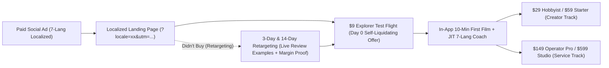

# SceneFlow Studio — Global Paid Social Promo Video Series (Omni 1.2 Flash · 10s Optimized · 7 Languages) & Paid Acquisition Strategy

A complete, production-ready **6-spot direct-response video ad series** specifically engineered for **Google Omni 1.2 Flash (`10s` clips, Standard REF Mode, `omniMultiShot=false`)** and global paid promotion across **YouTube, TikTok, Instagram Reels, LinkedIn, and regional video platforms** in **7 priority languages**: **English (`EN`), Spanish (`ES`), Portuguese (`PT`), Hindi (`HI`), Mandarin Chinese (`ZH-CN`), Arabic (`AR`), and Thai (`TH`)**.

---

## Omni 1.2 Flash (10s) Production Rules (`3 × 10s = 30s` · 1 Master → 7 Languages)

Switching from `5 × 6s` to **`3 × 10s`** cuts your total render volume by **40% (18 clips instead of 30 across all 6 spots)** while unlocking Omni 1.2 Flash's best cinematic flow:

1. **Single Continuous Take Per 10s Clip (`omniMultiShot=false`)**: Every 10-second block takes place inside **one coherent physical environment with one fluid camera move** — **zero split-screens, zero internal hard cuts, zero multi-clip montages, and zero morph effects** (which cause visual drift or temporal jitter in Omni).
2. **Strict 3-Phase Temporal Blocking (`0s–2s` → `2s–8s` → `8s–10s`)**: Matches SceneFlow's compiled Omni REF prompt grammar (`cleanOmniRefPrompt.ts` / `videoServicePromoScripts.ts`):
   - **`0s–2s (Start frame)`**: Anchors exact spatial layout, lighting temperature, subject posture, and prop position (stopping the thumb / beating YouTube's 5s skip immediately).
   - **`2s–8s (Action)`**: One smooth, physically grounded human gesture or environmental reveal — never crowded with competing actions.
   - **`8s–10s (End frame)`**: Deliberate calm **Settle On** composition that holds cleanly for `0.4s` cross-dissolves and localized end-card overlays.
3. **Zero Style-Token Clutter & Zero Readable Text**: Avoids generic buzzwords (`photorealistic`, `8K resolution`, `studio lighting`, `sharp focus`) in favor of **motivated practical light, concrete textures, and exact camera trajectories**. No text, logos, or readable UI inside generated frames — software presence is rendered via luminous light reflections or clean abstract geometry (`zero readable text`) so **1 visual master powers all 7 language dubs**.
4. **Explicit `No spoken dialogue.` Lock**: Every visual master ends with `No spoken dialogue.` so Omni 1.2 Flash never generates rogue mouth movement or unwanted voice bleed — keeping every master 100% lip-flap-free across `EN`, `ES`, `PT`, `HI`, `ZH-CN`, `AR`, and `TH`.
5. **Center-Safe Framing (`16:9` + `9:16` Ready) & Audio Mix Spec**:
   - Keep faces, hands, and focal props within the **center 60% vertical safe zone** so one `16:9` master crops effortlessly to `9:16` TikTok/Reels/Shorts.
   - Pace every 10-second block's voiceover to **`0.5s–9.4s` (~22–26 English words per block · ~68–76 words per 30s spot)** leaving `0.4s–0.6s` breath buffers around cuts.
   - **Audio Mix**: Studio VO at **`0 dB` (`-16 LUFS`)** over external instrumental score mixed at **`25%` (`-12 dB`)** — zero vocals in the score.

---

## Shared Continuity Reference Ingredients (Optional Reuse in Omni Standard REF Mode)

Locking these lightweight reference plates in your Reference Library (up to 8 ingredients per clip) ensures rock-solid visual consistency across the entire 6-spot ad campaign:

| Token | Name | Prompt Description (Rendering-Agnostic, Zero Text) | Used In |
|---|---|---|---|
| `person [1]` | **Studio Founder / Operator** *(or reuse `CHAR_ANA`)* | Confident 32-year-old creative director, warm brown eyes, dark wavy hair neatly styled, tailored charcoal knit overshirt over a matte black tee, calm composed expression. | `SVC-01`, `SVC-03`, `CRT-01`, `CRT-02` |
| `person [2]` | **Executive Client** | Approachable 45-year-old business executive, tailored slate blazer over a crisp light-gray shirt, thin titanium glasses, expressive brow. | `SVC-02` |
| `person [3]` | **Crimson Coat Protagonist** *(Drama Proof)* | Poised 34-year-old woman, long dark hair pulled half-back, deep-set eyes, tailored crimson wool trench coat with a small silver collar pin. | `CRT-01` (Block 02) |
| `location [1]` | **Minimalist Founder Studio** *(or reuse `LOC_STUDIO`)* | Sunlit modern workspace with a matte walnut/black desk, single dark-aluminum laptop, ceramic espresso cup, and floor-to-ceiling windows overlooking a soft-focus skyline, zero readable text. | `SVC-01`, `CRT-02` |
| `location [2]` | **Private Screening Room** | Intimate dark charcoal review lounge with a plush theater armchair facing a large glowing widescreen cinema display out of direct text readability, warm subtle floor sconce spill. | `CRT-01`, `SVC-02` |
| `prop [1]` | **Abstract Glass Meridian Globe** *(or reuse `UI_LANG_GLOBE`)* | Translucent rotating crystal globe composed of thin luminous meridian lines floating in deep obsidian space with seven iridescent light ribbons orbiting smoothly around it, zero flags or text. | `CRT-03` (Block 02) |

---

# PART 1 — VIDEO SERVICE & WHITE-LABEL AGENCY SPOTS (`SVC-01` to `SVC-03`)

Target Buyer: Solo video service operators, boutique marketing agencies, real estate media companies, corporate L&D vendors, life-memoir studios, and freelancers selling `$1,000–$5,000+` client films.

---

## SPOT `SVC-01` (v2) — "Beyond Random AI Clips: The Automated 4K Client Studio"
- **Primary Offer:** Operator Pro (`$149/mo` White-Label Business) · Entry Tripwire: `$9` Explorer Test Flight *(localized in thumbnails/descriptions)*
- **Core Differentiation vs. Other AI Video Tools:** Ordinary AI video generators only spit out disconnected 5-second clips with drifting faces and hours of manual stitching. SceneFlow is a **complete automated 4K studio platform** — Continuity Vault™, Walk-Away Production Agent, and 100% White-Label Client Portals.
- **Best Platforms:** YouTube In-Stream, YouTube Shorts, Meta/Instagram Reels, TikTok, LinkedIn
- **Assembly:** `3 × 10s` Omni 1.2 Flash clips (`0.4s` cross-dissolves) · `30s` total
- **30s Background Music Prompt (`-12 dB` / 25% under VO):**
  > *Instrumental modern commercial tech-cinema track, 30 seconds, 108 BPM, F minor lifting to A-flat major at 0:11. 0:00-0:10 tense muted bass pulse and subtle rhythmic clock-like percussion. 0:10-0:20 crisp upbeat synth pluck and warm confident Rhodes chords opening smoothly. 0:20-0:30 uplifting string swell and clean bass groove resolving on a resonant warm final chord. Instrumental only, no vocals.*

### Omni 1.2 Flash (10s) Shot-by-Shot Visual Spec (`SVC-01` v2)

| Block | Timecode | Omni 1.2 Flash (10s) Video Prompt (`omniMultiShot=false`, Single Continuous Take) | Localized On-Screen Super (Added in Post) |
|---|---|---|---|
| **Block 01** *(AI Clip Tool Trap)* | `0:00–0:10` | **0s–2s (Start frame):** Inside a dimly lit late-night agency editing bay, `person [1]` sits hunched between two wide curved monitors flickering with clashing discordant blocks of cool magenta, amber warning flashes, and mismatched abstract clip tiles (pure light shapes, zero readable text), two half-empty espresso cups beside a cluttered trackpad. **2s–8s (Action):** `person [1]` clicks rapidly trying to wrestle mismatched clips together, freezes abruptly as a harsh amber glare pulses across the desk, exhales heavily, pushes their chair back from the chaotic monitors, and rubs both temples in quiet exhaustion. **8s–10s (End frame):** Moody profile close-up of `person [1]` leaning back in shadowed blue-amber fatigue while the disorganized mismatched screens flicker behind them. **Camera:** Smooth slow lateral dolly creeping left-to-right past a foreground monitor edge into weary profile close-up. **No spoken dialogue.** | `0:00–0:05`: **Ordinary AI Tools = Random 5s Clips** `0:05–0:10`: **Drifting Faces · Endless Manual Stitching** |
| **Block 02** *(Automated Studio Platform)* | `0:10–0:20` | **0s–2s (Start frame):** Inside `location [1]` flooded with warm golden-hour sunlight, `person [1]` stands relaxed beside a sleek matte walnut desk where a wide curved studio display shows clean, orderly teal-to-emerald synchronized production lanes advancing smoothly in rhythm (pure geometric light bands, zero readable text). **2s–8s (Action):** `person [1]` reaches down gracefully with one hand to tap a single glowing cyan launch key on the dark-aluminum laptop, picks up a ceramic espresso cup with the other hand, smiles with calm confidence, and turns unhurriedly toward the sunlit floor-to-ceiling city window while the synchronized emerald production tracks finish smoothly on their own behind them. **8s–10s (End frame):** Serene sunlit three-quarter portrait with `person [1]` relaxed on the right third holding the espresso cup while the self-running studio glows softly across the left background. **Camera:** Fluid clockwise gimbal arc sweeping smoothly from the glowing automated desk to a poised sunlit portrait on the right third. **No spoken dialogue.** | `0:10–0:15`: **Continuity Vault™ · Walk-Away Agent** `0:15–0:20`: **End-to-End Automated 4K Studio** |
| **Block 03** *(White-Label Client Sign-Off + CTA)* | `0:20–0:30` | **0s–2s (Start frame):** Inside an upscale sunlit modern lounge with floor-to-ceiling greenery outside, a poised business executive and their partner sit comfortably together on a warm camel leather sofa holding a sleek widescreen tablet angled away from camera, rich golden cinema reflections illuminating their smiling faces, zero readable text. **2s–8s (Action):** Both exchange an impressed delighted nod as warm cinema light plays across their eyes; the executive reaches smoothly with their right index finger to tap a luminous emerald approval glow on the lower-right glass edge of the tablet, then relaxes back smiling warmly in the golden afternoon light. **8s–10s (End frame):** Calm symmetrical hold framing the smiling clients across the upper half with clean sunlit negative space across the lower third for the localized CTA end card. **Camera:** Gentle forward dolly arc transitioning smoothly into a slow symmetrical pull-back hold. **No spoken dialogue.** | `0:20–0:25`: **100% White-Label Portals · 90% Margin** `0:25–0:30`: **sceneflowai.studio** |

### 7-Language Voiceover Scripts (`SVC-01` v2 · Tight ~19–22 Words/Block · Currency-Agnostic Global Audio)

- **EN (English — 64 words):**
  - **Block 01 (`0:00–0:10`):** *"Ordinary AI tools only spit out random five-second clips — leaving you trapped babysitting prompts, fixing drifting faces, and stitching audio all night."*
  - **Block 02 (`0:10–0:20`):** *"SceneFlow Studio is a complete automated 4K production platform. Lock cast and sets in the Continuity Vault, launch the Production Agent, and walk away."*
  - **Block 03 (`0:20–0:30`):** *"Deliver memoirs, real estate, and corporate films through 100% white-label client portals — with up to ninety percent margins. Launch at sceneflowai.studio."*

- **ES (Spanish — Global Neutral):**
  - **Block 01 (`0:00–0:10`):** *"Las herramientas de IA comunes solo generan clips sueltos de cinco segundos, atrapándote toda la noche entre prompts, rostros cambiantes y edición manual."*
  - **Block 02 (`0:10–0:20`):** *"SceneFlow Studio es una plataforma completa de producción 4K automatizada. Bloquea elenco y locaciones en Continuity Vault, lanza el agente y aléjate."*
  - **Block 03 (`0:20–0:30`):** *"Entrega memorias, tours inmobiliarios y videos corporativos en portales 100% marca blanca, con hasta noventa por ciento de margen. Empieza en sceneflowai.studio."*

- **PT (Portuguese — Brazil/Global):**
  - **Block 01 (`0:00–0:10`):** *"Ferramentas comuns de IA só geram clipes soltos de cinco segundos — prendendo você a noite toda em prompts manuais, rostos inconsistentes e edição."*
  - **Block 02 (`0:10–0:20`):** *"O SceneFlow Studio é uma plataforma completa de produção 4K automatizada. Trave elenco e cenários no Continuity Vault, acione o agente e relaxe."*
  - **Block 03 (`0:20–0:30`):** *"Entregue memórias, tours imobiliários e filmes corporativos em portais 100% com a sua marca, com até noventa por cento de margem em sceneflowai.studio."*

- **HI (Hindi — Conversational Business):**
  - **Block 01 (`0:00–0:10`):** *"आम AI टूल सिर्फ़ पाँच सेकंड के अलग-अलग क्लिप देते हैं — जिससे आप पूरी रात प्रॉम्प्ट, बदलते चेहरों और मैनुअल एडिटिंग में उलझे रहते हैं।"*
  - **Block 02 (`0:10–0:20`):** *"SceneFlow Studio एक पूरा ऑटोमेटेड 4K प्रोडक्शन प्लेटफ़ॉर्म है। Continuity Vault में किरदार व सेट लॉक करें, Production Agent चलाएँ और निश्चिंत हो जाएँ।"*
  - **Block 03 (`0:20–0:30`):** *"100% अपने ब्रांड के क्लाइंट पोर्टल से मेमॉयर, रियल एस्टेट और कॉर्पोरेट फ़िल्में डिलीवर करें — 90 प्रतिशत तक मुनाफ़े के साथ। शुरू करें sceneflowai.studio पर।"*

- **ZH-CN (Mandarin Chinese):**
  - **Block 01 (`0:00–0:10`):** *"普通 AI 工具只会吐出随机的五秒碎片，让你整晚困在反复改提示词、修变脸和手动拼剪音频的噩梦里。"*
  - **Block 02 (`0:10–0:20`):** *"SceneFlow Studio 是全流程自动化 4K 制片平台：在连续性资产库锁定角色与场景，一键启动自动制片代理即可轻松离开。"*
  - **Block 03 (`0:20–0:30`):** *"通过 100% 白标客户门户交付传记、房产与企业宣传片，净利率高达 90%。立即访问 sceneflowai.studio 开启工作室。"*

- **AR (Modern Standard Arabic — Clean Commercial):**
  - **Block 01 (`0:00–0:10`):** *"أدوات الذكاء الاصطناعي العادية تنتج مقاطع عشوائية من خمس ثوانٍ فقط، فتتركك طوال الليل تصلح تغيّر الوجوه وتدمج الصوت يدوياً."*
  - **Block 02 (`0:10–0:20`):** *"SceneFlow Studio منصة إنتاج 4K آلية متكاملة. ثبّت الشخصيات والمواقع في خزنة الاستمرارية، شغّل وكيل الإنتاج، واتركه يبني الفيلم وحده."*
  - **Block 03 (`0:20–0:30`):** *"سلّم أفلام السيرة الذاتية والعقارات والتدريب عبر بوابات عملاء بعلامتك التجارية 100% بهوامش تصل لتسعين بالمئة عبر sceneflowai.studio."*

- **TH (Thai — Natural Business):**
  - **Block 01 (`0:00–0:10`):** *"เครื่องมือ AI ทั่วไปสร้างได้แค่คลิปสุ่มห้าวินาที ทำให้คุณต้องนั่งแก้พรอมต์ แก้หน้าตัวละครเพี้ยน และตัดต่อเสียงเองทั้งคืน"*
  - **Block 02 (`0:10–0:20`):** *"SceneFlow Studio คือแพลตฟอร์มผลิตวิดีโอ 4K อัตโนมัติครบวงจร ล็อกตัวละครและฉากใน Continuity Vault กดเริ่ม Production Agent แล้วปล่อยระบบทำงานได้เลย"*
  - **Block 03 (`0:20–0:30`):** *"ส่งมอบงานชีวประวัติ ทัวร์อสังหา และสื่อองค์กรผ่านพอร์ทัลแบรนด์ของคุณ 100% ทำกำไรสูงสุด 90 เปอร์เซ็นต์ เริ่มเลยที่ sceneflowai.studio"*

---

## SPOT `SVC-02` — "100% White-Label Client Portals — Zero Client Login"
- **Primary Offer:** Operator Pro (`$149/mo` White-Label Client Portals)
- **Best Platforms:** LinkedIn, YouTube In-Stream, Instagram Reels, TikTok
- **Assembly:** `3 × 10s` Omni 1.2 Flash clips (`0.4s` cross-dissolves) · `30s` total
- **30s Background Music Prompt (`-12 dB` / 25% under VO):**
  > *Instrumental sleek luxury corporate minimal track, 30 seconds, 100 BPM, C major. 0:00-0:10 soft restrained muted pluck bass with subtle cool electric piano chord creating gentle tension. 0:10-0:20 warm acoustic-electronic fingerstyle pulse and clean airy felt piano chords signaling effortless clarity. 0:20-0:30 lush warm cello harmony and polished crisp snap groove landing cleanly on a refined final tonic chord. Instrumental only, no vocals.*

### Omni 1.2 Flash (10s) Shot-by-Shot Visual Spec

| Block | Timecode | Omni 1.2 Flash (10s) Video Prompt (`omniMultiShot=false`, Single Continuous Take) | Localized On-Screen Super (Added in Post) |
|---|---|---|---|
| **Block 01** *(Hook + Pain)* | `0:00–0:10` | **0s–2s (Start frame):** Inside a bright minimalist glass-walled executive office, `person [2]` sits at a pale oak desk squinting skeptically at a glowing smartphone held in both hands beside a closed laptop and cold ceramic coffee mug, zero readable text. **2s–8s (Action):** `person [2]` taps the screen impatiently twice with their thumb, furrows their brow in visible frustration, sets the phone face-down firmly on the oak desk, and rubs the bridge of their nose beneath their titanium glasses. **8s–10s (End frame):** Tight medium close-up of `person [2]` leaning back in quiet impatience with the face-down phone resting in the lower foreground. **Camera:** Smooth slow forward dolly push-in from medium wide to expression close-up. **No spoken dialogue.** | `0:00–0:05`: **Clients Hate Logins & Email Chaos** `0:05–0:10`: **Late Changes Kill Your Video Margin** |
| **Block 02** *(Zero-Login Intake)* | `0:10–0:20` | **0s–2s (Start frame):** Inside a sunlit oak-beamed living room with warm late-morning window shafts, an approachable older homeowner couple sits comfortably side-by-side at a wooden dining table spread with faded vintage family snapshots, holding a sleek modern smartphone effortlessly over the photos, zero text. **2s–8s (Action):** The husband smoothly arranges two square vintage photographs side-by-side while the wife gently holds the smartphone steady, taps once cleanly on the glass edge, and both share a warm relaxed chuckle as a soft cyan light pulse illuminates the table surface. **8s–10s (End frame):** Warm over-the-shoulder close framing of their relaxed hands beside the cherished photographs and glowing phone in golden dust motes. **Camera:** Fluid lateral Steadicam glide arcing gently around the oak dining table. **No spoken dialogue.** | `0:10–0:15`: **Zero-Login Mobile Story Intake** `0:15–0:20`: **Branded 100% Under YOUR Studio** |
| **Block 03** *(Screening Room Approval + CTA)* | `0:20–0:30` | **0s–2s (Start frame):** Inside `location [2]` lit by warm amber floor sconces and deep charcoal architectural shadows, `person [2]` sits completely relaxed in a cognac leather armchair holding a sleek horizontal tablet facing them, warm cinema colors dancing across their glasses, zero readable text. **2s–8s (Action):** `person [2]` nods with satisfied executive approval, reaches gracefully with their right index finger to tap once on the lower-right corner of the tablet (casting a crisp emerald glow onto their fingertips), and settles comfortably back with a pleased smile. **8s–10s (End frame):** Clean dark architectural negative space opening cleanly across the lower half as `person [2]` sits relaxed in the upper-right third. **Camera:** Smooth over-the-shoulder-to-profile gimbal pull-back into wide clean hold. **No spoken dialogue.** | `0:20–0:25`: **Approve Blueprint → Sign Off in Screening Room** `0:25–0:30`: **100% White-Label · sceneflowai.studio** |

### 7-Language Voiceover Scripts (`SVC-02` · Timed to `3 × 10s` Blocks)

- **EN (English — 69 words):**
  - **Block 01 (`0:00–0:10`):** *"Clients hate creating accounts, digging through emails, and guessing what their video will look like — and late changes after rendering wipe out your margin."*
  - **Block 02 (`0:10–0:20`):** *"SceneFlow gives you 100% white-label client portals under your own brand. Clients share photos and voice stories straight from their phone with zero login."*
  - **Block 03 (`0:20–0:30`):** *"They approve your Blueprint before you spend video credits, leave timestamped notes, and sign off in your private Screening Room. Launch at sceneflowai.studio."*

- **ES (Spanish):**
  - **Block 01 (`0:00–0:10`):** *"Tus clientes odian crear cuentas, buscar correos y adivinar cómo quedará su video — y los cambios tardíos tras renderizar borran tu ganancia."*
  - **Block 02 (`0:10–0:20`):** *"SceneFlow te da portales 100% marca blanca bajo tu propio nombre. Tus clientes suben fotos y graban su historia desde el celular, sin registrarse."*
  - **Block 03 (`0:20–0:30`):** *"Aprueban el Blueprint antes de gastar créditos, dejan notas exactas por segundo y firman en tu sala privada. Descúbrelo en sceneflowai.studio."*

- **PT (Portuguese):**
  - **Block 01 (`0:00–0:10`):** *"Clientes detestam criar senhas, procurar anexos no e-mail e adivinhar o resultado — e alterações tardias após a renderização acabam com o seu lucro."*
  - **Block 02 (`0:10–0:20`):** *"O SceneFlow entrega portais 100% white-label com a sua marca. O cliente envia fotos e grava depoimentos pelo celular, sem precisar de login."*
  - **Block 03 (`0:20–0:30`):** *"Ele aprova o Blueprint antes de gastar créditos de vídeo, comenta no segundo exato e assina na sua sala privada. Conheça em sceneflowai.studio."*

- **HI (Hindi):**
  - **Block 01 (`0:00–0:10`):** *"क्लाइंट्स को अकाउंट बनाना, ईमेल में फ़ाइलें ढूँढना और अंदाज़ा लगाना पसंद नहीं — और रेंडर के बाद बदलाव आपका पूरा मुनाफ़ा खत्म कर देते हैं।"*
  - **Block 02 (`0:10–0:20`):** *"SceneFlow देता है 100% व्हाइट-लेबल क्लाइंट पोर्टल — आपके अपने ब्रांड में। क्लाइंट बिना लॉगिन फ़ोन से फ़ोटो और आवाज़ साझा करते हैं।"*
  - **Block 03 (`0:20–0:30`):** *"वीडियो क्रेडिट खर्च करने से पहले Blueprint स्वीकृत होता है, फिर आपकी निजी स्क्रीनिंग रूम में टाइमस्टैम्प नोट्स के साथ फ़ाइनल मंज़ूरी। शुरू करें sceneflowai.studio पर।"*

- **ZH-CN (Mandarin Chinese):**
  - **Block 01 (`0:00–0:10`):** *"客户讨厌注册账号、在邮件里翻找附件，更怕成片出来不对版——渲染后再大改，你的利润瞬间清零。"*
  - **Block 02 (`0:10–0:20`):** *"SceneFlow 为你提供 100% 白标定制客户门户。客户无需登录，用手机即可直接上传照片并口述故事素材。"*
  - **Block 03 (`0:20–0:30`):** *"消耗算力前先锁定蓝图，随后在你的专属放映厅打点批注并一键签字批准。立即体验：sceneflowai.studio。"*

- **AR (Modern Standard Arabic):**
  - **Block 01 (`0:00–0:10`):** *"يكره العملاء إنشاء الحسابات والبحث في البريد الإلكتروني وتخمين شكل الفيديو — وأي تعديل متأخر بعد الرندر يلتهم ربحك فوراً."*
  - **Block 02 (`0:10–0:20`):** *"يمنحك SceneFlow بوابات عملاء بعلامتك التجارية 100%. يرفع العميل صوره ويسجل قصته من هاتفه دون أي تسجيل دخول."*
  - **Block 03 (`0:20–0:30`):** *"يعتمد العميل المخطط قبل إنفاق رصيد الفيديو، ويترك ملاحظاته بالثانية ويمنحك الموافقة في قاعة عرضك الخاصة عبر sceneflowai.studio."*

- **TH (Thai):**
  - **Block 01 (`0:00–0:10`):** *"ลูกค้าไม่ชอบสมัครบัญชี ค้นหาไฟล์ในอีเมล หรือคอยเดาว่าวิดีโอจะออกมาเป็นแบบไหน และถ้าขอแก้หลังเรนเดอร์ กำไรของคุณก็หายวับทันที"*
  - **Block 02 (`0:10–0:20`):** *"SceneFlow มอบพอร์ทัลลูกค้าแบบ White-Label 100% ภายใต้แบรนด์ของคุณ ลูกค้าอัปโหลดรูปและอัดเสียงเล่าเรื่องจากมือถือได้โดยไม่ต้องล็อกอิน"*
  - **Block 03 (`0:20–0:30`):** *"อนุมัติโครงเรื่องก่อนใช้เครดิตสร้างวิดีโอ แล้วปักหมุดคอมเมนต์ตามวินาทีพร้อมกดอนุมัติในห้องฉายส่วนตัวของคุณ เริ่มเลยที่ sceneflowai.studio"*

---

## SPOT `SVC-03` — "Scale From 1 Solo Operator to 100+ Client Projects"
- **Primary Offer:** Agency Scale Studio (`$599/mo`, 10 Team Seats, Custom Domain, Multi-PM Ops)
- **Best Platforms:** LinkedIn, YouTube In-Stream (Retargeting & Agency Lookalikes), Meta
- **Assembly:** `3 × 10s` Omni 1.2 Flash clips (`0.4s` cross-dissolves) · `30s` total
- **30s Background Music Prompt (`-12 dB` / 25% under VO):**
  > *Instrumental driving modern electronic-orchestral momentum score, 30 seconds, 116 BPM, D minor shifting to F major at 0:11. 0:00-0:10 tight pulsing analog arpeggio and deep moody sub-bass. 0:10-0:20 crisp rhythmic syncopated percussion and soaring bright staccato strings locking into smooth forward momentum. 0:20-0:30 expansive triumphant orchestral synth swell settling onto a clean wide confident chord. Instrumental only, no vocals.*

### Omni 1.2 Flash (10s) Shot-by-Shot Visual Spec

| Block | Timecode | Omni 1.2 Flash (10s) Video Prompt (`omniMultiShot=false`, Single Continuous Take) | Localized On-Screen Super (Added in Post) |
|---|---|---|---|
| **Block 01** *(Scaling Bottleneck)* | `0:00–0:10` | **0s–2s (Start frame):** Inside a dim dark studio late at night, `person [1]` sits hunched between two wide curved monitors displaying chaotic overlapping amber-and-slate abstract window blocks (shapes only, zero readable text), surrounded by three half-empty espresso cups and stacks of paper folders. **2s–8s (Action):** `person [1]` types rapidly across a mechanical keyboard, freezes suddenly as an amber reflection pulses steadily across the desk surface, and leans back running both hands slowly through their hair in quiet overwhelm. **8s–10s (End frame):** Medium wide shot holding on `person [1]` dwarfed by the cluttered glowing monitors in cold blue night shadow. **Camera:** Slow continuous backward dolly pull-out amplifying the isolation of working alone. **No spoken dialogue.** | `0:00–0:05`: **2 Clients → 50 Clients a Month?** `0:05–0:10`: **Single-User AI Tools Break Fast** |
| **Block 02** *(Multi-PM Studio Harmony)* | `0:10–0:20` | **0s–2s (Start frame):** Inside a bright sunlit modern glass-walled boutique studio loft, `person [1]` stands calmly beside a wide frosted architectural wall display glowing with clean horizontal teal-to-emerald abstract progress lanes (pure light bands, zero text) while two diverse project producers sit smoothly at matching minimalist desks nearby. **2s–8s (Action):** `person [1]` gestures effortlessly toward the synchronized green light bars as both producers look up, share calm confident nods in unison, and glide their hands smoothly over their trackpads in effortless rhythm. **8s–10s (End frame):** Balanced architectural medium-wide composition of the calm high-output team bathed in crisp daylight and soft emerald screen sheen. **Camera:** Smooth left-to-right lateral Steadicam glide past the glass studio table. **No spoken dialogue.** | `0:10–0:15`: **6-Column Kanban · PM Credit Caps** `0:15–0:20`: **0-Credit QA Seats · 100+ Projects** |
| **Block 03** *(Global Walk-Away Scale + CTA)* | `0:20–0:30` | **0s–2s (Start frame):** Inside the sleek studio loft overlooking a sparkling blue-hour twilight city skyline through floor-to-ceiling glass, `person [1]` stands calmly holding a warm ceramic coffee mug while serene golden-cyan light waves flow steadily across a dark wall monitor behind them, zero text. **2s–8s (Action):** `person [1]` takes an unhurried sip of coffee, turns gently toward the glowing twilight skyline outside, and smiles with quiet executive calm as the automated studio continues running effortlessly behind them. **8s–10s (End frame):** Clean architectural framing placing `person [1]` in the upper-left third with deep twilight glass negative space across the lower-center frame for the localized end card. **Camera:** Slow elevated eye-level dolly pull-back into serene wide hold. **No spoken dialogue.** | `0:20–0:25`: **7-Language Auto-Routing · Custom Domain** `0:25–0:30`: **Agency Scale · sceneflowai.studio** |

### 7-Language Voiceover Scripts (`SVC-03` · Timed to `3 × 10s` Blocks)

- **EN (English — 69 words):**
  - **Block 01 (`0:00–0:10`):** *"What happens when your video business jumps from two clients a month to fifty? Most AI tools fall apart the second you hire Project Managers."*
  - **Block 02 (`0:10–0:20`):** *"SceneFlow Agency Scale is built for hundreds of active productions — with Kanban SLA tracking, monthly PM credit caps, and zero-credit QA reviewer seats."*
  - **Block 03 (`0:20–0:30`):** *"Auto-route multilingual clients across seven languages, launch walk-away automated builds, and deliver on your custom domain. Explore Agency Scale at sceneflowai.studio."*

- **ES (Spanish):**
  - **Block 01 (`0:00–0:10`):** *"¿Qué pasa cuando tu negocio de video salta de dos clientes al mes a cincuenta? Casi todas las herramientas de IA colapsan en cuanto contratas equipo."*
  - **Block 02 (`0:10–0:20`):** *"SceneFlow Agency Scale soporta cientos de proyectos activos: tablero Kanban con alertas SLA, límites mensuales por PM y revisores de calidad sin consumo de créditos."*
  - **Block 03 (`0:20–0:30`):** *"Enruta clientes en siete idiomas, activa producción autónoma y entrega bajo tu propio dominio. Escala hoy en sceneflowai.studio."*

- **PT (Portuguese):**
  - **Block 01 (`0:00–0:10`):** *"O que acontece quando sua produtora salta de dois clientes por mês para cinquenta? Quase toda ferramenta de IA quebra quando você contrata gestores."*
  - **Block 02 (`0:10–0:20`):** *"O SceneFlow Agency Scale suporta centenas de produções simultâneas, com Kanban de SLA, limites mensais por PM e revisores de QA com custo zero de créditos."*
  - **Block 03 (`0:20–0:30`):** *"Direcione clientes em sete idiomas, ative produção autônoma e entregue no seu domínio próprio. Escale sem um exército de editores em sceneflowai.studio."*

- **HI (Hindi):**
  - **Block 01 (`0:00–0:10`):** *"जब आपका वीडियो बिज़नेस महीने के दो क्लाइंट से पचास पर पहुँचता है, तो क्या होता है? ज़्यादातर AI टूल टीम जोड़ते ही बिखर जाते हैं।"*
  - **Block 02 (`0:10–0:20`):** *"SceneFlow Agency Scale सैकड़ों प्रोजेक्ट्स के लिए बना है — Kanban SLA ट्रैकिंग, हर PM के लिए क्रेडिट कैप और 0-क्रेडिट QA रिव्यूअर सीट्स के साथ।"*
  - **Block 03 (`0:20–0:30`):** *"सात भाषाओं में क्लाइंट ऑटो-रूट करें, ऑटोनॉमस प्रोडक्शन चलाएँ और अपने कस्टम डोमेन पर डिलीवर करें — sceneflowai.studio पर।"*

- **ZH-CN (Mandarin Chinese):**
  - **Block 01 (`0:00–0:10`):** *"当你的视频业务从每月 2 个客户暴增到 50 个时，流程撑得住吗？大多数 AI 工具一旦引入项目团队就会彻底失控。"*
  - **Block 02 (`0:10–0:20`):** *"SceneFlow 机构版专为数百个并发项目打造：看板 SLA 追踪、PM 月度点数上限、零消耗 QA 审核席位一应俱全。"*
  - **Block 03 (`0:20–0:30`):** *"自动分流七大语种全球客户，启动无人值守自动制片，并以你的专属域名交付成片。访问 sceneflowai.studio。"*

- **AR (Modern Standard Arabic):**
  - **Block 01 (`0:00–0:10`):** *"ماذا يحدث عندما يقفز عملك في إنتاج الفيديو من عميلين شهرياً إلى خمسين؟ تنهار معظم أدوات الذكاء الاصطناعي فور توظيف مديري مشاريع."*
  - **Block 02 (`0:10–0:20`):** *"صُمم SceneFlow Agency Scale لمئات المشاريع النشطة — مع لوحة Kanban لمراقبة المواعيد، وسقف رصيد لكل مدير، ومقاعد جودة بلا استهلاك رصيد."*
  - **Block 03 (`0:20–0:30`):** *"وجّه العملاء عبر سبع لغات، وشغّل الإنتاج الآلي، وسلّم أعمالك على نطاقك الخاص دون جيش من المحررين عبر sceneflowai.studio."*

- **TH (Thai):**
  - **Block 01 (`0:00–0:10`):** *"จะเกิดอะไรขึ้นเมื่อธุรกิจวิดีโอของคุณโตจากเดือนละ 2 โปรเจกต์ เป็น 50 โปรเจกต์? เครื่องมือ AI ส่วนใหญ่มักพังทันทีที่คุณเริ่มสร้างทีม"*
  - **Block 02 (`0:10–0:20`):** *"SceneFlow Agency Scale สร้างมาเพื่อรองรับงานนับร้อยพร้อมกัน ทั้งบอร์ด Kanban ติดตาม SLA จำกัดเครดิตรายเดือนของ PM และบทบาท QA ที่ไม่เสียเครดิต"*
  - **Block 03 (`0:20–0:30`):** *"กระจายงานลูกค้า 7 ภาษาอัตโนมัติ สั่งผลิตงานแบบปล่อยทิ้งไว้ได้ และส่งมอบบนโดเมนของคุณเอง ที่ sceneflowai.studio"*

---

# PART 2 — CREATORS, AUTHORS & SHOWRUNNERS SPOTS (`CRT-01` to `CRT-03`)

Target Buyer: YouTube/TikTok storytellers, indie filmmakers, book authors, podcasters, educators, and AI video enthusiasts frustrated by disconnected 5-second clip generators.

---

## SPOT `CRT-01` — "Stop Generating Random 5-Second Clips — Build Worlds"
- **Primary Offer:** `$9` Explorer Test Flight → `$29` Hobbyist / `$59` Starter
- **Best Platforms:** YouTube Shorts & In-Stream, TikTok, Instagram Reels
- **Assembly:** `3 × 10s` Omni 1.2 Flash clips (`0.4s` cross-dissolves) · `30s` total
- **30s Background Music Prompt (`-12 dB` / 25% under VO):**
  > *Instrumental theatrical cinema trailer score, 30 seconds, 92 BPM, E minor lifting into soaring G major at 0:11. 0:00-0:10 sparse moody cello pulse and faint restless sub-bass tension. 0:10-0:20 sweeping lush strings and warm French horn swell building genuine feature-film emotion. 0:20-0:30 grand restrained orchestral cadence resolving cleanly onto one lingering solo piano note. Instrumental only, no vocals.*

### Omni 1.2 Flash (10s) Shot-by-Shot Visual Spec

| Block | Timecode | Omni 1.2 Flash (10s) Video Prompt (`omniMultiShot=false`, Single Continuous Take) | Localized On-Screen Super (Added in Post) |
|---|---|---|---|
| **Block 01** *(Clip Fatigue & Drift)* | `0:00–0:10` | **0s–2s (Start frame):** Inside a dimly lit late-night indie creator desk studio, `person [1]` sits in three-quarter profile wearing over-ear headphones while jagged, jarring reflections of clashing magenta, cold acid green, and pale blue light flicker across their face from an off-camera display, zero readable text. **2s–8s (Action):** `person [1]` clicks the mouse twice with growing exasperation, exhales sharply, pulls the headphones off around their neck, and rests their chin heavily in their left palm staring past the discordant screen glare. **8s–10s (End frame):** Quiet close profile of `person [1]` framed in dim slate-blue shadow as the uneven screen glow slows to a tired pulse. **Camera:** Slow creeping lateral dolly track from left to right. **No spoken dialogue.** | `0:00–0:05`: **Faces Changing Every 5 Seconds?** `0:05–0:10`: **Random Clips Burn Credits Fast** |
| **Block 02** *(Unbroken Continuity Showcase)* | `0:10–0:20` | **0s–2s (Start frame):** On a rain-slicked neon city sidewalk at night bathed in cool cobalt streetlamp reflections, `person [3]` in her tailored crimson wool coat and silver collar pin stands poised facing the camera under light steady rain, zero readable storefront text. **2s–8s (Action):** `person [3]` walks five calm unhurried paces forward toward the camera, pushes open the brass-handled glass door of a warm 1950s jazz diner, and steps smoothly across the threshold from cool blue rain straight into rich 2700K golden tungsten light — her face, hairstyle, silver collar pin, and rain-beaded crimson coat remaining completely consistent across the entire lighting transition. **8s–10s (End frame):** Poised cinematic medium close-up of `person [3]` pausing gracefully inside the warm golden doorway with wet neon bokeh softly glowing outside behind her. **Camera:** Fluid continuous backward Steadicam glide leading `person [3]` effortlessly through the doorway. **No spoken dialogue.** | `0:10–0:15`: **Lock Faces, Voices & Worlds Forever** `0:15–0:20`: **Continuity Vault™ · Zero Face Drift** |
| **Block 03** *(Theatrical Master + CTA)* | `0:20–0:30` | **0s–2s (Start frame):** Inside `location [2]`, `person [1]` sits centered in a dark charcoal theater armchair watching a wide glowing widescreen projection across the front wall (out of direct readability), bathed in rich golden-cyan cinema glow dancing across their eyes. **2s–8s (Action):** `person [1]` leans slightly forward in quiet creative pride, breaks into a warm genuine smile as golden theatrical light sweeps across the room, and settles calmly back against the headrest. **8s–10s (End frame):** Symmetrical over-the-shoulder pull-back opening clean deep-charcoal negative space across the lower half of the frame for the localized CTA end card. **Camera:** Smooth symmetrical dolly pull-back with gentle upward tilt. **No spoken dialogue.** | `0:20–0:25`: **Blueprint → Voiced Animatic → 4K Master** `0:25–0:30`: **Build Worlds, Not Clips · Try for `$9`** |

### 7-Language Voiceover Scripts (`CRT-01` · Timed to `3 × 10s` Blocks)

- **EN (English — 70 words):**
  - **Block 01 (`0:00–0:10`):** *"Tired of AI video generators where your main character turns into a stranger every five seconds? Random clips aren't a movie — and retries burn your budget fast."*
  - **Block 02 (`0:10–0:20`):** *"SceneFlow Studio is built for real storytelling. Lock your script in the Blueprint Room, then lock every face, outfit, voice, and location in the Continuity Vault."*
  - **Block 03 (`0:20–0:30`):** *"Preview your full voiced animatic before spending video credits, then render a cohesive 4K cinema master. Start your first film for nine dollars at sceneflowai.studio."*

- **ES (Spanish):**
  - **Block 01 (`0:00–0:10`):** *"¿Cansado de generadores con IA donde tu protagonista cambia de cara cada cinco segundos? Clips sueltos no hacen una película y queman tu presupuesto rapidísimo."*
  - **Block 02 (`0:10–0:20`):** *"SceneFlow Studio está hecho para contar historias reales. Cierra tu guion en el Blueprint Room y bloquea rostros, vestuario, voces y locaciones en el Continuity Vault."*
  - **Block 03 (`0:20–0:30`):** *"Revisa tu animatic con voces antes de renderizar video y exporta tu máster en 4K. Empieza tu primera película por nueve dólares en sceneflowai.studio."*

- **PT (Portuguese):**
  - **Block 01 (`0:00–0:10`):** *"Cansado de geradores com IA onde seu protagonista vira outra pessoa a cada cinco segundos? Clipes aleatórios não formam um filme e queimam seus créditos rápido."*
  - **Block 02 (`0:10–0:20`):** *"O SceneFlow Studio foi feito para histórias de verdade. Estruture no Blueprint Room e trave rostos, figurinos, vozes e cenários no Continuity Vault."*
  - **Block 03 (`0:20–0:30`):** *"Assista ao animatic completo com vozes antes de gerar vídeo e renderize seu master em 4K. Comece seu primeiro filme por nove dólares em sceneflowai.studio."*

- **HI (Hindi):**
  - **Block 01 (`0:00–0:10`):** *"क्या आप ऐसे AI वीडियो टूल से थक चुके हैं जहाँ हर पाँच सेकंड में हीरो का चेहरा बदल जाता है? छोटे क्लिप से फ़िल्म नहीं बनती — सिर्फ़ क्रेडिट बर्बाद होते हैं।"*
  - **Block 02 (`0:10–0:20`):** *"SceneFlow Studio असली कहानियों के लिए बना है। Blueprint Room में कहानी लॉक करें और Continuity Vault में हर चेहरा, पहनावा, आवाज़ और लोकेशन फिक्स करें।"*
  - **Block 03 (`0:20–0:30`):** *"वीडियो क्रेडिट खर्च करने से पहले पूरा वॉइस एनिमेटिक देखें — फिर 4K मास्टर तैयार करें। sceneflowai.studio पर सिर्फ़ नौ डॉलर में शुरू करें।"*

- **ZH-CN (Mandarin Chinese):**
  - **Block 01 (`0:00–0:10`):** *"受够了每隔五秒主角就变脸的 AI 视频工具吗？随机拼凑的碎片不是电影，反复抽卡只会迅速烧光你的预算。"*
  - **Block 02 (`0:10–0:20`):** *"SceneFlow Studio 专为完整叙事而生：先在蓝图室锁定剧本，再将角色面孔、服装、音色与场景锁进连续性资产库。"*
  - **Block 03 (`0:20–0:30`):** *"消耗视频点数前先看完整配音预演，确认无误一键渲染连贯的 4K 电影母带。9 美元开启你的首部电影：sceneflowai.studio。"*

- **AR (Modern Standard Arabic):**
  - **Block 01 (`0:00–0:10`):** *"هل سئمت من أدوات الفيديو التي تغيّر ملامح بطل قصتك كل خمس ثوانٍ؟ المقاطع العشوائية لا تصنع فيلماً وتحرق رصيدك بسرعة."*
  - **Block 02 (`0:10–0:20`):** *"صُمم SceneFlow Studio لسرد قصص حقيقية. ثبّت الحبكة في Blueprint Room، واقفل الوجوه والأزياء والأصوات والمواقع في خزنة الاستمرارية."*
  - **Block 03 (`0:20–0:30`):** *"شاهد النسخة الأولية الكاملة بالصوت قبل إنفاق رصيد الفيديو، ثم أخرج فيلماً متكاملاً بدقة 4K. ابدأ بتسعة دولارات على sceneflowai.studio."*

- **TH (Thai):**
  - **Block 01 (`0:00–0:10`):** *"เบื่อไหมกับ AI สร้างวิดีโอที่เปลี่ยนหน้าตัวเอกทุกห้าวินาที? คลิปสุ่มสั้นๆ ไม่สามารถเป็นหนังได้ และยังผลาญเครดิตของคุณอย่างรวดเร็ว"*
  - **Block 02 (`0:10–0:20`):** *"SceneFlow Studio สร้างมาเพื่อการเล่าเรื่องจริง ล็อกโครงเรื่องใน Blueprint Room แล้วล็อกใบหน้า ชุด เสียง และฉากทั้งหมดใน Continuity Vault"*
  - **Block 03 (`0:20–0:30`):** *"ดู Animatic ที่มีเสียงพากย์ครบก่อนใช้เครดิตสร้างวิดีโอ แล้วค่อยเรนเดอร์มาสเตอร์ 4K เริ่มสร้างหนังเรื่องแรกเพียง 9 ดอลลาร์ที่ sceneflowai.studio"*

---

## SPOT `CRT-02` — "300 Manual Prompts vs. Walk-Away Production Agent"
- **Primary Offer:** `$9` Explorer Test Flight → `$59` Starter / `$149` Pro
- **Best Platforms:** TikTok, YouTube Shorts, Instagram Reels, YouTube In-Stream
- **Assembly:** `3 × 10s` Omni 1.2 Flash clips (`0.4s` cross-dissolves) · `30s` total
- **30s Background Music Prompt (`-12 dB` / 25% under VO):**
  > *Instrumental bright modern upbeat electronic-piano track, 30 seconds, 112 BPM, A major. 0:00-0:10 crisp playful staccato percussion and ticking rimshot creating energetic urgency. 0:10-0:20 clean drop into a breezy uplifting Rhodes piano melody, warm bassline, and effortless snapping beat. 0:20-0:30 sunny feel-good synth pads and crisp melodic chime resolving cleanly on an open airy major chord. Instrumental only, no vocals.*

### Omni 1.2 Flash (10s) Shot-by-Shot Visual Spec

| Block | Timecode | Omni 1.2 Flash (10s) Video Prompt (`omniMultiShot=false`, Single Continuous Take) | Localized On-Screen Super (Added in Post) |
|---|---|---|---|
| **Block 01** *(300-Prompt Grind)* | `0:00–0:10` | **0s–2s (Start frame):** Inside a dim late-night home studio, `person [1]` leans close over a glowing mechanical keyboard at a cluttered desk as rapid scrolling streaks of cool screen light slide across their face, zero readable text. **2s–8s (Action):** `person [1]` types relentlessly for three seconds, freezes abruptly as a dull amber reflection flashes across the desk, lets both hands fall limp from the keyboard, and leans far back into the chair rubbing both tired eyes. **8s–10s (End frame):** Hold on `person [1]` gazing silently upward in dim midnight lamp light while the static amber glare lingers across the keyboard. **Camera:** Slow tight forward dolly push-in past the mechanical keyboard toward their weary expression. **No spoken dialogue.** | `0:00–0:05`: **10-Min Film = 300+ Manual Prompts** `0:05–0:10`: **One Error Stalls Your Whole Night** |
| **Block 02** *(Tap Launch & Walk Away)* | `0:10–0:20` | **0s–2s (Start frame):** Inside `location [1]` flooded with crisp morning daylight, `person [1]` stands relaxed beside the clean matte black desk where a sleek dark wall display behind them shows soft abstract cyan-and-emerald light bars rising cleanly in rhythm (shapes only, zero readable text). **2s–8s (Action):** `person [1]` reaches down to tap one single glowing cyan key on the desk once with their right index finger, picks up a warm terracotta coffee mug with their left hand, smiles effortlessly, and walks unhurriedly out of frame to the left while the soft emerald light bands continue filling smoothly across the wall display all on their own. **8s–10s (End frame):** Serene locked composition of the empty sunlit studio desk running smoothly by itself in warm morning sunbeams. **Camera:** Smooth gentle lateral dolly glide right-to-left settling peacefully on the autonomous desk after `person [1]` exits. **No spoken dialogue.** | `0:10–0:15`: **Tap Production Agent. Walk Away.** `0:15–0:20`: **Self-Healing Shots · Auto-Mixed Audio** |
| **Block 03** *(Café Phone Ping + CTA)* | `0:20–0:30` | **0s–2s (Start frame):** On a breezy sunlit outdoor café terrace under dappled olive-tree shade, `person [1]` relaxes in a woven bistro chair beside a small marble table holding an iced coffee, a sleek smartphone resting face-up next to a white saucer. **2s–8s (Action):** The smartphone screen wakes with a clean soft cyan glow; `person [1]` lifts it casually with both hands, rotates it smoothly into landscape view, and breaks into a bright delighted smile as warm golden cinema light reflects softly across their cheeks. **8s–10s (End frame):** Sunlit lifestyle hold framing the smiling creator in the upper half with soft-bokeh warm marble table negative space across the lower third for the localized end card. **Camera:** Smooth clockwise gimbal arc pulling softly back into balanced daylight framing. **No spoken dialogue.** | `0:20–0:25`: **Private Screening Room Sent to Your Phone** `0:25–0:30`: **You Direct. SceneFlow Builds. · `$9` Trial** |

### 7-Language Voiceover Scripts (`CRT-02` · Timed to `3 × 10s` Blocks)

- **EN (English — 71 words):**
  - **Block 01 (`0:00–0:10`):** *"Making one ten-minute AI film used to mean three hundred manual image, voice, and video prompts — where one blocked shot ruins your whole evening."*
  - **Block 02 (`0:10–0:20`):** *"With SceneFlow's Production Agent, you spend under an hour perfecting your script, click launch, and walk away while it locks references, mixes audio, and auto-heals failed shots."*
  - **Block 03 (`0:20–0:30`):** *"When it's done, your private Screening Room link pings straight to your phone. You direct the story — SceneFlow builds the film. Try it for nine dollars at sceneflowai.studio."*

- **ES (Spanish):**
  - **Block 01 (`0:00–0:10`):** *"Crear una película con IA de diez minutos antes exigía trescientos prompts manuales de imagen, voz y video — y un plano bloqueado arruinaba toda tu noche."*
  - **Block 02 (`0:10–0:20`):** *"Con el Production Agent de SceneFlow pules tu guion en menos de una hora, pulsas iniciar y te alejas mientras bloquea referencias, mezcla audio y corrige tomas solas."*
  - **Block 03 (`0:20–0:30`):** *"Al terminar, el enlace de tu sala privada llega directo a tu celular. Tú diriges la historia; SceneFlow construye la película. Pruébalo por nueve dólares en sceneflowai.studio."*

- **PT (Portuguese):**
  - **Block 01 (`0:00–0:10`):** *"Fazer um filme de dez minutos com IA exigia trezentos prompts manuais de imagem, voz e vídeo — e um único plano bloqueado travava sua noite inteira."*
  - **Block 02 (`0:10–0:20`):** *"Com o Production Agent do SceneFlow, você dedica menos de uma hora ao roteiro, clica em iniciar e sai da tela enquanto ele trava o elenco, mixa o áudio e corrige falhas sozinho."*
  - **Block 03 (`0:20–0:30`):** *"Quando termina, o link da sua sala privada chega direto no seu celular. Você dirige a história; o SceneFlow constrói o filme. Teste por nove dólares em sceneflowai.studio."*

- **HI (Hindi):**
  - **Block 01 (`0:00–0:10`):** *"दस मिनट की एक AI फ़िल्म बनाने के लिए तीन सौ मैनुअल प्रॉम्प्ट लिखने पड़ते थे — और एक भी शॉट अटकने पर पूरी रात बर्बाद हो जाती थी।"*
  - **Block 02 (`0:10–0:20`):** *"SceneFlow के Production Agent के साथ स्क्रिप्ट परफेक्ट करें, लॉन्च दबाएँ और टहलने निकल जाएँ — एजेंट खुद किरदार लॉक करता है, ऑडियो मिलाता है और अटकने वाले शॉट ठीक करता है।"*
  - **Block 03 (`0:20–0:30`):** *"फ़िल्म तैयार होते ही प्राइवेट स्क्रीनिंग रूम लिंक सीधे आपके फ़ोन पर आता है। कहानी आप डायरेक्ट करें, फ़िल्म SceneFlow बनाएगा। sceneflowai.studio पर नौ डॉलर से शुरू करें।"*

- **ZH-CN (Mandarin Chinese):**
  - **Block 01 (`0:00–0:10`):** *"过去做一条十分钟的 AI 影片需要三百多次繁琐提示词，只要有一个镜头卡壳，一整晚就白费了。"*
  - **Block 02 (`0:10–0:20`):** *"有了 SceneFlow 自动制片代理，不到一小时打磨好剧本即可一键启动并离开——它自动锁定角色、混音配乐并智能修复失败镜头。"*
  - **Block 03 (`0:20–0:30`):** *"成片完成后放映室链接直接推送到你的手机。你负责导演故事，SceneFlow 构建电影。9 美元立即体验：sceneflowai.studio。"*

- **AR (Modern Standard Arabic):**
  - **Block 01 (`0:00–0:10`):** *"كان إنتاج فيلم مدته عشر دقائق يتطلب ثلاثمئة أمر يدوي للصور والصوت والفيديو — ولقطة واحدة متعثرة كانت تضيع سهرتك بالكامل."*
  - **Block 02 (`0:10–0:20`):** *"مع وكيل الإنتاج في SceneFlow، تتقن السيناريو بأقل من ساعة وتضغط تشغيل وتتركه يثبّت الشخصيات ويمزج الصوت ويصلح اللقطات المتعثرة تلقائياً."*
  - **Block 03 (`0:20–0:30`):** *"وفور الجاهزية يصلك رابط قاعة العرض مباشرة على هاتفك. أنت تخرج القصة وSceneFlow يبني الفيلم. جرّبه بتسعة دولارات عبر sceneflowai.studio."*

- **TH (Thai):**
  - **Block 01 (`0:00–0:10`):** *"เมื่อก่อนการทำหนังสั้น AI สิบนาทีต้องพิมพ์พรอมต์เองกว่าสามร้อยครั้ง แค่ช็อตเดียวติดขัด คืนทั้งคืนของคุณก็พังทันที"*
  - **Block 02 (`0:10–0:20`):** *"แต่ด้วย Production Agent ของ SceneFlow ใช้เวลาไม่ถึงชั่วโมงขัดเกลาบท กดเริ่ม แล้วลุกไปพัก ระบบจะล็อกตัวละคร มิกซ์เสียง และแก้ช็อตที่ล้มเหลวให้อัตโนมัติ"*
  - **Block 03 (`0:20–0:30`):** *"เมื่อเสร็จสมบูรณ์ ลิงก์ห้องฉายส่วนตัวจะส่งตรงเข้ามือถือทันที คุณกำกับเรื่องราว SceneFlow สร้างหนังให้เอง ทดลองเพียง 9 ดอลลาร์ที่ sceneflowai.studio"*

---

## SPOT `CRT-03` — "One Film, Seven Global Languages — Multiply Your Audience"
- **Primary Offer:** `$9` Explorer Test Flight → `$59` Starter / `$149` Pro (Global Channels, Series & Podcasters)
- **Best Platforms:** TikTok, YouTube Shorts, Instagram Reels, YouTube In-Stream *(massive performer in `ES`, `PT`, `HI`, `TH`, `AR`, `ZH` markets!)*
- **Assembly:** `3 × 10s` Omni 1.2 Flash clips (`0.4s` cross-dissolves) · `30s` total
- **30s Background Music Prompt (`-12 dB` / 25% under VO):**
  > *Instrumental energetic global cinema percussion and soaring strings score, 30 seconds, 114 BPM, G minor expanding to B-flat major at 0:11. 0:00-0:10 intimate solo acoustic hand-drum pulse and warm deep bass note. 0:10-0:20 shimmering crystalline synth arpeggio joined by sweeping global percussion and luminous layered strings blooming outward. 0:20-0:30 joyful wide orchestral groove peaking cleanly and fading into a warm uplifting final chord. Instrumental only, no vocals.*

### Omni 1.2 Flash (10s) Shot-by-Shot Visual Spec

| Block | Timecode | Omni 1.2 Flash (10s) Video Prompt (`omniMultiShot=false`, Single Continuous Take) | Localized On-Screen Super (Added in Post) |
|---|---|---|---|
| **Block 01** *(One-Language Ceiling)* | `0:00–0:10` | **0s–2s (Start frame):** Inside a quiet dark acoustic broadcast studio, a charismatic storyteller (`person [1]`) sits at a matte desk behind a suspended studio condenser microphone lit by a single narrow warm amber overhead spotlight while the wide studio space around them remains shrouded in deep obsidian shadow, zero text. **2s–8s (Action):** `person [1]` gently lifts their studio headphones off their ears, sets them neatly beside the microphone, and looks thoughtfully outward past the tight edge of the single amber spotlight into the vast unlit darkness surrounding them. **8s–10s (End frame):** Evocative wide-medium settle framing `person [1]` alone inside one narrow golden beam amid expansive shadow. **Camera:** Slow wide-angle backward dolly pull-out revealing how small the single spotlight looks inside the huge dark studio. **No spoken dialogue.** | `0:00–0:05`: **Why Limit Your Channel to 1 Language?** `0:05–0:10`: **Dubbing Used to Cost `$1,000s`/Episode** |
| **Block 02** *(7-Language Stem Alchemy)* | `0:10–0:20` | **0s–2s (Start frame):** Suspended in deep obsidian cinematic darkness, a single warm golden luminous audio light-wave travels cleanly from left to right toward `prop [1]` (a translucent crystal meridian globe floating at center frame), zero text, zero flags. **2s–8s (Action):** As the golden wave enters the crystal globe, it smoothly splits into seven synchronized iridescent ribbons (gold, cyan, emerald, coral, violet, sky-blue, amber) orbiting gracefully around the rotating crystal meridians while one pure unbroken golden cinema band glides steadily above them untouched. **8s–10s (End frame):** Majestic stabilized composition of the glowing glass globe haloed by all seven shimmering harmonious ribbons turning calmly in darkness. **Camera:** Slow fluid 180-degree orbital dolly glide sweeping gracefully around the glowing globe. **No spoken dialogue.** | `0:10–0:15`: **1 Click → 7+ Global Dubbed Tracks** `0:15–0:20`: **Original Music & SFX Stay Untouched** |
| **Block 03** *(Worldwide Audience + CTA)* | `0:20–0:30` | **0s–2s (Start frame):** On a warm twilight rooftop lounge framed by soft golden string lights and a glittering metropolitan skyline at blue hour, three diverse friends sit close together on a deep lounge sofa sharing a bright horizontal widescreen tablet tilted away from camera, zero readable text. **2s–8s (Action):** All three lean forward captivated as warm cinema hues illuminate their faces, then break into genuine delighted smiles and point enthusiastically toward the glowing tablet as evening city lights sparkle across the horizon behind them. **8s–10s (End frame):** Expansive rising twilight composition keeping the smiling friends and glowing skyline framed across the upper half with rich deep-indigo negative space across the lower third for the localized end card. **Camera:** Smooth rising jib-style gimbal pull-back into wide twilight hold. **No spoken dialogue.** | `0:20–0:25`: **Zero Extra Video Re-Rendering** `0:25–0:30`: **Publish Globally · Start for `$9`** |

### 7-Language Voiceover Scripts (`CRT-03` · Timed to `3 × 10s` Blocks)

- **EN (English — 69 words):**
  - **Block 01 (`0:00–0:10`):** *"Why publish your videos in only one language when the whole world is watching? Hiring voice actors and remixing global dubs used to cost thousands per episode."*
  - **Block 02 (`0:10–0:20`):** *"Inside SceneFlow Studio, build your series once — then dub every episode into Spanish, Portuguese, Hindi, Mandarin, Arabic, Thai, and more in minutes."*
  - **Block 03 (`0:20–0:30`):** *"Your original sound effects and score stay completely untouched, with zero extra video rendering costs. Multiply your global audience for nine dollars at sceneflowai.studio."*

- **ES (Spanish):**
  - **Block 01 (`0:00–0:10`):** *"¿Por qué publicar tus historias en un solo idioma cuando todo el mundo está mirando? Contratar doblaje y remezclar audio solía costar miles por episodio."*
  - **Block 02 (`0:10–0:20`):** *"En SceneFlow Studio produces tu serie una sola vez y doblas cada episodio a inglés, portugués, hindi, chino, árabe, tailandés y más en minutos."*
  - **Block 03 (`0:20–0:30`):** *"Tus efectos de sonido y música original quedan intactos, sin volver a renderizar el video. Multiplica tu audiencia global por nueve dólares en sceneflowai.studio."*

- **PT (Portuguese):**
  - **Block 01 (`0:00–0:10`):** *"Por que publicar suas histórias em um único idioma quando o mundo inteiro está assistindo? Contratar dubladores e remixar trilhas custava milhares por episódio."*
  - **Block 02 (`0:10–0:20`):** *"No SceneFlow Studio você cria sua série uma vez e dubla cada episódio para inglês, espanhol, hindi, mandarim, árabe, tailandês e muito mais em minutos."*
  - **Block 03 (`0:20–0:30`):** *"Seus efeitos sonoros e trilha permanecem intactos, sem renderizar o vídeo de novo. Multiplique sua audiência global por nove dólares em sceneflowai.studio."*

- **HI (Hindi):**
  - **Block 01 (`0:00–0:10`):** *"जब पूरी दुनिया देख रही है, तो अपने वीडियो सिर्फ़ एक भाषा में क्यों डालें? ग्लोबल डबिंग और साउंड रीमिक्स में हर एपिसोड लाखों खर्च होते थे।"*
  - **Block 02 (`0:10–0:20`):** *"SceneFlow Studio में अपनी सीरीज़ एक बार बनाएँ — और मिनटों में अंग्रेज़ी, स्पैनिश, पुर्तगाली, चीनी, अरबी और थाई में डब करें।"*
  - **Block 03 (`0:20–0:30`):** *"आपके मूल साउंड इफ़ेक्ट और म्यूज़िक बिल्कुल सुरक्षित रहते हैं, बिना दोबारा वीडियो रेंडर किए। sceneflowai.studio पर नौ डॉलर में ग्लोबल ऑडियंस बढ़ाएँ।"*

- **ZH-CN (Mandarin Chinese):**
  - **Block 01 (`0:00–0:10`):** *"全世界都在看视频，为什么把你的频道局限在单一语言里？过去请配音、重做多语种混音，每集动辄数千美元。"*
  - **Block 02 (`0:10–0:20`):** *"在 SceneFlow Studio 里只需制作一次剧集，几分钟就能一键配音为英语、西语、葡语、印地语、阿拉伯语和泰语。"*
  - **Block 03 (`0:20–0:30`):** *"原片音效与配乐完整保留，完全无需重新渲染画面，极低成本撬动全球流量。9 美元开启体验：sceneflowai.studio。"*

- **AR (Modern Standard Arabic):**
  - **Block 01 (`0:00–0:10`):** *"لماذا تنشر فيديوهاتك بلغة واحدة بينما العالم بأسره يشاهد؟ كانت الدبلجة وإعادة المكساج للقنوات العالمية تكلف آلاف الدولارات لكل حلقة."*
  - **Block 02 (`0:10–0:20`):** *"داخل SceneFlow Studio، أنتج سلسلتك مرة واحدة — ثم دبلج كل حلقة إلى الإنجليزية والإسبانية والبرتغالية والهندية والصينية والتايلاندية خلال دقائق."*
  - **Block 03 (`0:20–0:30`):** *"تبقى المؤثرات الصوتية والموسيقى الأصلية كما هي دون إعادة رندر الفيديو. ضاعف جمهورك العالمي بتسعة دولارات عبر sceneflowai.studio."*

- **TH (Thai):**
  - **Block 01 (`0:00–0:10`):** *"ทำไมต้องลงวิดีโอแค่ภาษาเดียว ในเมื่อคนทั้งโลกกำลังรอชม? เมื่อก่อนการจ้างนักพากย์และมิกซ์เสียงสำหรับช่องต่างประเทศมีค่าใช้จ่ายมหาศาลต่อตอน"*
  - **Block 02 (`0:10–0:20`):** *"ใน SceneFlow Studio สร้างซีรีส์แค่ครั้งเดียว แล้วพากย์เสียงเป็นภาษาอังกฤษ สเปน โปรตุเกส ฮินดี จีน อาหรับ และอีกหลายภาษาได้ในไม่กี่นาที"*
  - **Block 03 (`0:20–0:30`):** *"ซาวด์เอฟเฟกต์และดนตรีประกอบต้นฉบับยังคงอยู่ครบ โดยไม่ต้องเรนเดอร์วิดีโอใหม่ ขยายผู้ชมทั่วโลกวันนี้เพียง 9 ดอลลาร์ที่ sceneflowai.studio"*

---

# PART 2B — ZERO-EXTRA-RENDER 15s CUTDOWNS & 10s SINGLE-TAKE HOOK LAB (TIKTOK / SHORTS / REELS)

With 10-second Omni masters, you can test short-form paid hooks in **two ultra-efficient ways**:

### Option A — Zero-Extra-Render `15s` Cutdowns (`7.5s + 7.5s` from Existing 10s Masters)
Trim **Block 02 (`0:00–0:07.5`)** + **Block 03 (`0:02.5–0:10.0`)** with a `0.3s` dissolve to assemble high-converting 15s social ads with **zero extra Omni generations**:
1. **Creator Cutdown (`15s` — from `CRT-01` Blocks 02 + 03):** *"Stop paying `$100`/month to gamble on random 5-second AI clips. SceneFlow locks your script, faces, voices, and 4K scenes in one continuous studio. Start your first film for `$9` at sceneflowai.studio."*
2. **Agency Cutdown (`15s` — from `SVC-01` Blocks 02 + 03):** *"What if one laptop could deliver `$2,500` white-label client films — memoirs, real estate, and training — with zero client login and 80% margins? Test-drive SceneFlow Studio for `$9` at sceneflowai.studio."*
3. **Global Dubbing Cutdown (`15s` — from `CRT-03` Blocks 02 + 03):** *"One YouTube episode. Seven global languages. Zero video re-rendering. SceneFlow dubs your cast while keeping your music and SFX intact. Try it for `$9` at sceneflowai.studio."*

### Option B — Optional `1 × 10s` Single-Take Scroll-Stopper Micro-Ads (TikTok / YouTube Shorts)
If you want pure **10-second single-clip ads** (1 Omni 1.2 Flash clip = 1 complete ad, ~24 English words VO):
- **`MICRO-01` (Walk-Away Hook — `10s`):** Reuse **`CRT-02` Block 02** verbatim. VO (`0.4s–9.4s`): *"Stop writing three hundred manual AI prompts. Perfect your script, tap Production Agent, and walk away while SceneFlow builds your 4K film. Try for `$9` at sceneflowai.studio."*
- **`MICRO-02` (Continuity Hook — `10s`):** Reuse **`CRT-01` Block 02** verbatim. VO (`0.4s–9.4s`): *"No face drift. No wardrobe glitches. Lock your entire cast, voices, and sets in SceneFlow's Continuity Vault and render real 4K cinema. Start for `$9` at sceneflowai.studio."*
- **`MICRO-03` (Agency Margin Hook — `10s`):** Reuse **`SVC-01` Block 02** verbatim. VO (`0.4s–9.4s`): *"Run a 4K client video studio from one laptop — memoirs, real estate, and training with white-label portals and up to 90% margins. Test flight `$9` at sceneflowai.studio."*

---

# PART 3 — GLOBAL PAID PROMOTION STRATEGY (POST-DEC 3 LAUNCH)

## 1. Campaign Funnel & Business Goals

SceneFlow's `$9` **Explorer Test Flight** is an extraordinary paid-media weapon: it **self-liquidates ad spend** (covering 35%–60% of acquisition cost on Day 0) while filtering out freebie hunters so your GPU compute only serves high-intent buyers.

### Target KPI Benchmarks (90-Day Ramp)

| Funnel Metric | Target Benchmark | Kill / Scale Rule |
|---|---|---|
| **3-Sec Thumb-Stop Rate** (TikTok / Reels) | **> 35%** | Pause creative if `< 25%` after `$100` spend; swap Block 01 opening hook or caption |
| **YouTube View Rate** (30s or completion) | **> 28%** | Tighten 0–5s vocal hook & super if `< 20%` |
| **Outbound CTR** | **> 1.5%** (Search/YT) · **> 1.2%** (Social) | Scale top 20% CTR × Conversion winners |
| **Cost per `$9` Explorer Purchase (CPA)** | **Tier 1: `$15–$28`** · **Tier 2/3: `$5–$14`** | Remember `$9` cash returns Day 0 → net CAC is only **`$6–$19`** in Tier 1! |
| **Explorer → Paid Subscription Conversion** (30d) | **22%–35%** | Driven by in-app Studio Academy + Day 3/7/14 automated lifecycle emails |
| **Blended 90-Day ROAS** | **> 3.0x** (Creator) · **> 5.0x** (Operator Pro / Studio) | Shift 60%+ budget into highest LTV:CAC geos & Service spots |

---

## 2. Target Audience Architecture (2 Distinct Ad Accounts / Campaign Groups)

Never mix Creators and Video Service Agencies in the same ad set — they have completely different triggers, bids, and LTVs:

### Segment A: Video Service & White-Label Agencies *(45% of Launch Budget — Highest LTV)*
- **Core Personas:**
  1. Freelance videographers / editors looking to 5x output without hiring.
  2. Real estate media agencies & broker marketing teams.
  3. Corporate L&D / HR training consultants & SOP agencies.
  4. Side-hustle digital entrepreneurs launching Life Memoir / Brand Story studios (including retirees/boomer legacy services).
- **Best Spots:** `SVC-01` (Margin Hook), `SVC-02` (White-Label Portals), `SVC-03` (Agency Scale Multi-PM).
- **Primary Conversion Event:** `$9` Explorer Purchase OR direct `$149/mo` Operator Pro Checkout.
- **Targeting Signals:**
  - *YouTube Custom Intent Keywords:* "how to start a video production agency", "real estate video editing outsourcing", "corporate training video software", "white label AI video", "Synthesia / HeyGen / Runway alternative".
  - *Meta / TikTok Interests:* Video Production, Digital Marketing Agency, Real Estate Marketing, Freelancing, GoHighLevel, Adobe Premiere Pro, DaVinci Resolve, SaaS Entrepreneurship.
  - *LinkedIn Job Titles / Functions:* Founder / Owner (Media Production, Marketing Services, Real Estate, E-Learning), Creative Director, Head of L&D, Video Producer.

### Segment B: Creators, Authors & Showrunners *(55% of Launch Budget — Highest Volume & Viral Loop)*
- **Core Personas:**
  1. YouTube faceless / storytelling / sci-fi / documentary / animated comedy channels.
  2. Indie authors & screenwriters adapting novels/scripts into films & trailers.
  3. Podcasters turning audio episodes into multi-language visual shows.
  4. Frustrated users of Kling, Runway, Midjourney, Luma, Sora, or Pika who want continuity & complete films.
- **Best Spots:** `CRT-01` (Build Worlds, Not Clips), `CRT-02` (Walk-Away Production Agent), `CRT-03` (1 Film → 7 Languages).
- **Primary Conversion Event:** `$9` Explorer Purchase (`checkoutTier=explorer`).
- **Targeting Signals:**
  - *YouTube Custom Intent & Placements:* Competitor tutorials ("Runway Gen-4 tutorial", "Kling AI consistent character", "Veo 3 workflow", "ElevenLabs dubbing", "how to make an AI short film"), filmmaking & screenwriting channels.
  - *TikTok / Reels Hashtags & Interests:* `#aifilm`, `#aivideo`, `#storytelling`, `#youtubecreator`, `#indiefilmmaker`, `#screenwriting`, `#selfpublishing`, `#facelessyoutube`.

---

## 3. Platform-by-Platform Playbook

| Platform | Budget Share | Best Aspect & Length | Best Spots | Strategic Role |
|---|---|---|---|---|
| **YouTube (In-Stream + Shorts)** | **40%** | 16:9 (30s In-Stream) + 9:16 (10s/15s/30s Shorts) | All 6 (`CRT-01`, `CRT-02`, `SVC-01`, `CRT-03`) | **#1 High-Intent Closer.** Creators & agency founders actively search AI filmmaking & editing tutorials here; YouTube Custom Intent keywords convert at 2x–3x cold social. |
| **TikTok (In-Feed + Spark Ads)** | **25%** | 9:16 (10s micro + 15s cutdowns + 30s full) | `CRT-01`, `CRT-02`, `CRT-03`, `SVC-01` | **Lowest-CPM Global Scale & Hook Lab.** Huge arbitrage in **BR (`PT`), MX/LATAM (`ES`), TH (`TH`), MENA (`AR`)**; turn top organic posts into Spark Ads for social proof. |
| **Meta (Instagram Reels + FB Feed)** | **20%** | 9:16 (Reels) + 4:5 (Feed) | `SVC-01`, `SVC-02`, `CRT-01`, `CRT-03` | **Best Retargeting + SMB/Memoir Reach.** Unmatched for real estate brokers, boutique agency owners, and 45+ memoir/author buyers + 14-day cart-abandonment retargeting. |
| **LinkedIn Video Ads** | **10%** | 16:9 / 1:1 (30s) | `SVC-02`, `SVC-03`, `SVC-01` | **Precision B2B Agency & Corporate L&D.** Higher CPM (`$25–$45`), but a single `$599/mo` Studio annual client (`$7,188/yr`) pays for months of spend. |
| **Chinese Diaspora / Regional (`ZH-CN`)** | **5%** | 9:16 & 16:9 (`ZH-CN` dub) | `CRT-01`, `CRT-03`, `SVC-01` | Start with **YouTube + Meta (`ZH-CN` targeting US/CA/AU/SG/TW/MY)** using Whop global checkout first; expand to Xiaohongshu / Bilibili creator seeding once China payment rails are added. |

---

## 4. 7-Language Geo-Tiering & Smart Budget Allocation

Don't spread budget evenly across all 7 languages on Day 1 — tier by **purchasing power × CPM arbitrage**:

| Geo Tier | Languages & Priority Markets | Expected CPM | Strategy & Offer Focus |
|---|---|---|---|
| **Tier 1 — High LTV Anchor** *(50% budget)* | **`EN`** (US, CA, UK, AU) + **`AR` Gulf** (UAE, Saudi Arabia, Qatar) | `$14–$28` | Push both **Creator (`$9` → `$59`)** and **Agency White-Label (`$149` / `$599`)**. UAE/KSA has huge enterprise/real-estate video budgets and massive appetite for localized Arabic AI cinema. |
| **Tier 2 — High-Velocity Growth** *(35% budget)* | **`ES`** (Spain, Mexico, Colombia, US Hispanic), **`PT`** (Brazil), **`ZH-CN`** (Singapore, Taiwan, Overseas US/CA/AU) | `$4–$11` | **Massive creator + agency arbitrage.** Brazil & Spanish-speaking YouTube/agency markets are booming; `CRT-03` (7-language dubbing) + `SVC-01` crush here at 1/3rd of US CPMs. |
| **Tier 3 — Ultra-Low-CPM Scale** *(15% budget)* | **`HI`** (India — Tier-1 metros: Mumbai, Bengaluru, Delhi, Hyderabad) + **`TH`** (Thailand — Bangkok, Chiang Mai, Phuket) | `$1.50–$5` | Target **export-oriented agencies & global YouTube creators** (Indian & Thai agencies love selling `$1,500–$3,000` English/global videos to US/EU clients using SceneFlow!). Focus on `SVC-01`, `SVC-03`, and `CRT-03`. |

---

## 5. Phased 90-Day Launch & Testing Roadmap (Post-Dec 3)

### Phase 1 — Creative & Conversion Validation (Weeks 1–3 · `$1,500–$3,000` test budget)
- Launch **`EN` + `ES` + `PT`** first (lowest operational friction, proven Whop card conversion).
- Produce just **6 Omni 1.2 Flash 10s clips first** (`CRT-01` [3 clips] + `SVC-01` [3 clips]) — which instantly unlocks both **30s masters**, **15s cutdowns**, and **10s micro-ads** across **YouTube Custom Intent + Meta Reels + TikTok**.
- Route every ad directly to localized landing URLs with UTM + locale pre-selected:
  - Example: `https://sceneflowai.studio/?locale=es&utm_source=tiktok&utm_campaign=svc01_es&utm_content=block01`
- **Verify server-side conversion tracking** (Meta CAPI + Google Ads / YouTube Enhanced Conversions + TikTok Events API firing on **Whop `$9` Explorer purchase** and **Subscription upgrade** — optimize for *Purchases*, never just *Link Clicks*!).

### Phase 2 — Global 7-Language Expansion & Winner Scaling (Weeks 4–8 · `$3,000–$10,000/mo`)
- Render the remaining 4 spots (`12` Omni 10s clips) and roll winning spots into **`AR` (UAE/KSA)**, **`HI` (India metros)**, **`TH` (Thailand)**, and **`ZH-CN` (SG/TW/Diaspora)** using the same visual masters + localized dubs & captions.
- Launch **Spot `CRT-03` (1 Film → 7 Languages)** heavily across `ES`, `PT`, `HI`, `TH`, and `AR` — where local creators immediately grasp the value of publishing into high-RPM English/US YouTube markets!
- Turn on **Retargeting Layer (15% of budget)**:
  - **Days 1–7 Website Visitors (Non-Buyers):** Show `SVC-02` (White-Label Portals) or `CRT-02` (Walk-Away Agent) + real Production Examples trailer clips.
  - **Days 8–14 Checkout Abandoners:** `15s` cutdowns + *"Try the full Studio for `$9` — zero recurring obligation."*

### Phase 3 — Creator Seeding & Affiliate Flywheel (Weeks 9–12)
- Pair paid ads with **10–15 mid-tier AI filmmaking & agency YouTubers** (1–2 per language: EN, ES, PT, HI, ZH, AR, TH) who get a free Operator Pro account + **25%–30% recurring affiliate rev-share** via Whop, then whitelist/Spark-Ad their best 30-second walkthrough clips!

---

> [!TIP]
> **Highest-Leverage First Move**: Generate just **6 Omni 1.2 Flash 10s clips** (`CRT-01` + `SVC-01`). That single batch covers both Creator and White-Label Agency tracks, auto-yields 30s + 15s + 10s variants with zero extra renders, and immediately shows which track pays back fastest across your 7 markets!
